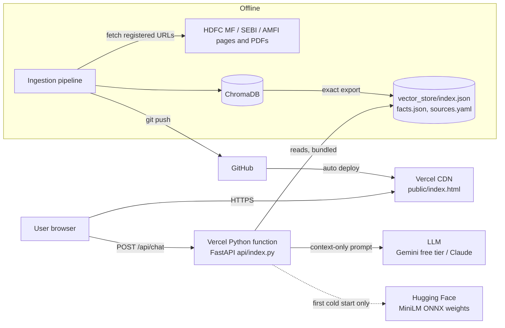
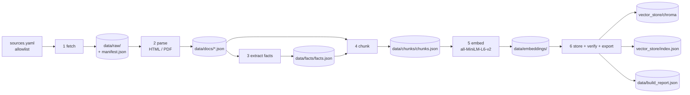
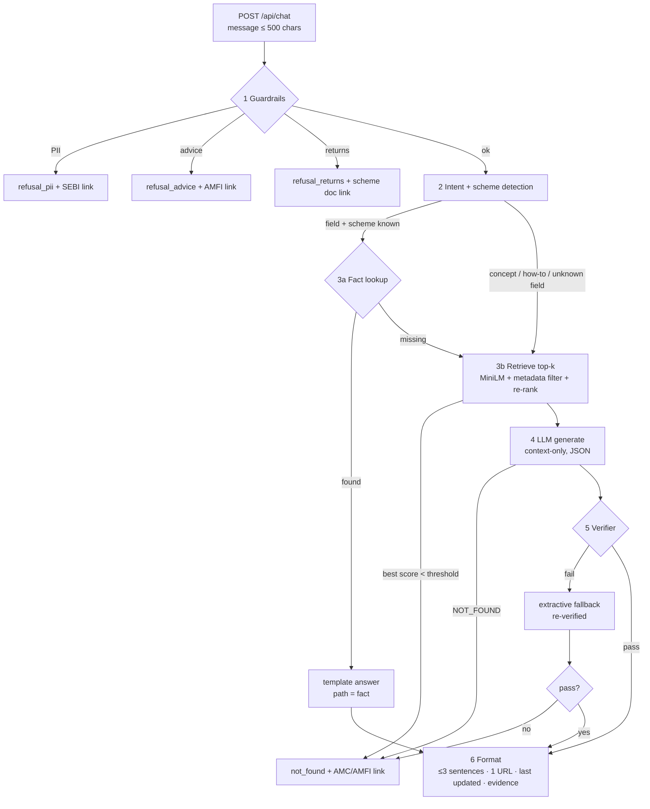
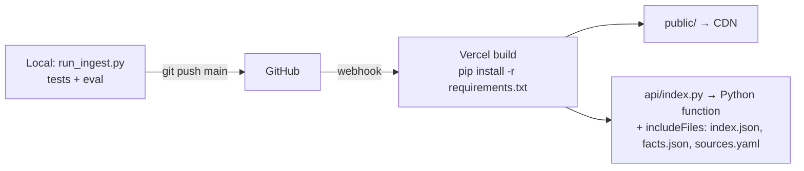

# Architecture: FundFacts AI

| | |
|---|---|
| **Derived from** | [PRD.md](PRD.md) |
| **Status** | Draft for review |
| **Last updated** | 09 Nov 2026 |

FundFacts AI has two halves that share one configuration and one data contract:

- **Ingestion** runs offline, on a laptop or in CI. It turns 15–25 registered official URLs into structured scheme facts and a ChromaDB vector index. It writes every stage to disk so each step can be inspected and explained.
- **Serving** runs on Vercel. It answers one question per request: guardrails first, then exact fact lookup, then retrieval plus an LLM. A verifier must approve every answer before it is returned.

The guiding principle is **deterministic before generative**. Anything that can be answered from an extracted, quoted fact is answered without the LLM. The LLM only phrases answers to conceptual questions, and code checks every number it writes.

---

## 1. System context

**Trust boundaries**
- **User input is untrusted.** It never reaches storage or logs. The question text is only sent to the LLM after the guardrails pass.
- **Fetched pages are data, not instructions.** Their text only enters the LLM prompt inside a delimited context block.
- **LLM output is untrusted until the verifier approves it.**

---

## 2. Ingestion pipeline (offline)

| Stage | Module | Input → Output | Key rules |
|---|---|---|---|
| 1 Fetch | `ingest/fetch.py` | `sources.yaml` → `data/raw/<source_id>.{html,pdf}` + `manifest.json` | Only `status: active` URLs; **no link following**; records HTTP status, `fetched_at` (UTC), `sha256`, content type; polite delay; `status: manual` reads from `data/manual/` instead |
| 2 Parse | `ingest/parse_html.py`, `parse_pdf.py` | raw → `data/docs/<source_id>.json` (`pages[{n, text}]`, `title`, `doc_date`) | HTML: main-content blocks (`h1–h4/p/li/td`), boilerplate removed; PDF: `pypdf` text per page, `pdfplumber` for tables; detects the printed "as on" date |
| 3 Extract facts | `ingest/extract_facts.py` | scheme docs (KIM/SID) → `facts.json` | Per-field extractors (regex + table lookup), each emitting `value`, `page` and a verbatim `quote`; **a field that can't be found is recorded as `missing`, never guessed**; returns/performance tables are skipped |
| 4 Chunk | `ingest/chunk.py` | docs + facts → `chunks.json` | Strategy per document type (§2.1); `chunk_id = <source_id>::p<page>::<n>` |
| 5 Embed | `ingest/embed_store.py` | chunks → vectors | `sentence-transformers/all-MiniLM-L6-v2`, normalised 384-d (cosine = dot product) |
| 6 Store | `ingest/embed_store.py` | vectors → ChromaDB collection `fundfacts` (cosine) | Rebuilt from scratch each run; **verifies** Chroma count = chunk count and no ids missing; exports `index.json`; writes `build_report.json` |

### 2.1 Chunking strategy
| Document type | Strategy | Why |
|---|---|---|
| Scheme facts (from `facts.json`) | One **fact card** per scheme topic (costs, minimums, risk and benchmark, lock-in, management, objective), written as sentences that start with the scheme name | Precise retrieval; the citation always matches the scheme asked about |
| KIM / SID PDFs | Page-bounded, section-aware packing of ~700 characters, ~120 overlap; a chunk never crosses a page, so citations can name the page | Long legal documents; page-level traceability |
| SEBI / AMFI articles and FAQs | Block-aware packing (paragraphs and list items kept whole), title prefixed | Short explainer content |

### 2.2 Build report
`data/build_report.json` lists: sources fetched, blocked or manual; pages parsed; fact coverage per scheme and field (`found` / `missing`); chunk count; Chroma count; export count. It doubles as the evidence for "are all chunks in the vector DB?".

---

## 3. Serving: query pipeline

### Step 1: Guardrails (`query/guardrails.py`)
Pure functions with no I/O, run before anything else. Order: **PII → advice → returns**.

| Check | Detects | Response |
|---|---|---|
| PII | PAN `[A-Z]{5}\d{4}[A-Z]`, Aadhaar (12 digits), Indian mobile numbers, email, OTP mentions, 8–18 digit account/folio numbers, "my PAN/folio/account" phrases | `refusal_pii`; the value is **never echoed** back |
| Advice | should I / recommend / best or better fund / worth investing / good time to / which one should I / my portfolio | `refusal_advice` + AMFI/SEBI education link |
| Returns | returns, CAGR, XIRR, performance, outperform, "how much will I earn" (excluding tax questions like "how are returns taxed") | `refusal_returns` + the scheme's official document |

### Step 2: Intent and scheme detection (`query/intent.py`)
- **Scheme:** alias table (e.g. "tax saver", "ELSS" → `hdfc_elss`; "midcap", "mid cap" → `hdfc_mid_cap`). The longest alias match wins.
- **Field:** keyword map to the fact enum (e.g. "TER", "expense ratio" → `expense_ratio`; "lock-in" → `lock_in`; "min SIP" → `min_sip`).
- Deterministic rules keep this explainable and testable. No LLM is used for routing.

### Step 3a: Fact lookup (`query/fact_lookup.py`)
If both `scheme` and `field` are known and `facts.json` has a `found` value, the answer comes from a template such as *"The expense ratio of {scheme} ({plan}) is {value} as on {as_of}."* It cites that fact's source URL and page. No LLM is involved, so this path cannot invent numbers.

Questions that name a field but no scheme (e.g. "ELSS lock-in?") use the scheme implied by the category alias, or fall through to retrieval.

### Step 3b: Retrieval (`query/retriever.py`)
1. Embed the query with the **same** MiniLM model.
2. Search: ChromaDB locally, or the `index.json` export with NumPy on Vercel. Both apply the same `where scheme_id = …` filter when a scheme is detected.
3. Over-fetch `3 × top_k`, then **re-rank**:
   - +0.08 for chunks of the detected scheme
   - −0.08 for chunks of other schemes
   - up to +0.12 for exact query bigrams found in the chunk (a small lexical signal for terms like "capital gains")
4. Keep `top_k = 4`. If the best score is below `min_similarity` (0.25), return `not_found`.
5. Every score adjustment is recorded in `evidence`, so a reviewer can see why a chunk won.

### Step 4: Generation (`llm/`)
- **Clients:** `llm/router.py` picks the provider (`LLM_PROVIDER`, default `auto`): **Gemini** (`llm/gemini_client.py`, free tier, `GEMINI_API_KEY`, default `gemini-2.5-flash`), else **Claude** (`llm/claude_client.py`, `ANTHROPIC_API_KEY`), else no LLM. Both expose `generate(system, user) -> str`; a quota error or failure raises `LLMUnavailable` and the verified-quote fallback is used.
- **Prompt contract:**
  - use only the numbered context
  - ≤ 3 sentences
  - no advice, opinions or returns
  - reply `NOT_FOUND` if the answer isn't in the context
  - output JSON `{"answer": str, "chunk_id": str}`
- Settings: temperature 0.1, max 400 tokens, 30 s timeout. Errors and timeouts go to the extractive fallback.

### Step 5: Verifier (`query/verifier.py`)
A response is approved only if **all** of these hold:

| Rule | Check |
|---|---|
| V1 Citation exists | `chunk_id` is one of the retrieved chunks (not invented) |
| V2 URL verified | The chunk's `source_id` resolves to an `active`/`manual` entry in `sources.yaml`; that URL is the one returned |
| V3 Numbers grounded | Every number or percentage in the answer (e.g. `1.01%`, `₹500`, `3 years`) appears in the cited chunk after normalisation (₹/Rs/INR, commas, "three" ↔ "3") |
| V4 Length | ≤ 3 sentences after trimming; URLs stripped from the text |
| V5 Policy | The answer text does not trip the advice or returns guardrails |

On failure, the system tries the **extractive fallback**: the best-matching sentences from the top chunk, which are then re-verified. If that also fails, it returns `not_found`. It never returns an unverified answer.

### Step 6: Response
The answer follows the contract in PRD §5. `last_updated` is the cited source's `fetched_at`, converted to IST. When the document has a printed as-of date (`doc_date`), the text says so (e.g. "as on 31 Oct 2026").

---

## 4. Data stores and schemas

| Store | Format | Written by | Read by | In Git? |
|---|---|---|---|---|
| `sources.yaml` | YAML | human | fetch, verifier, API | yes |
| `data/raw/` | HTML/PDF + `manifest.json` | fetch | parse | yes (demo of each stage) |
| `data/docs/` | JSON | parse | extract, chunk | yes |
| `data/facts/facts.json` | JSON | extract | fact lookup, chunk | yes |
| `data/chunks/chunks.json` | JSON | chunk | embed | yes |
| `data/embeddings/` | JSON | embed | store | yes |
| `vector_store/chroma/` | ChromaDB (SQLite + HNSW) | store | local retrieval | yes |
| `vector_store/index.json` | JSON (ids, text, metadata, vectors) | store | Vercel retrieval | yes |

Schemas are defined once as Pydantic models in `fundfacts/schemas.py` (`Source`, `RawFetch`, `Document`, `Fact`, `Chunk`, `Evidence`, `Answer`) and validated when written and when loaded. The field-level definitions are in [FundFacts_AI_plan.md §4](FundFacts_AI_plan.md).

**No store holds user input.** The API has no database, no request logging of message bodies, and no analytics.

---

## 5. Deployment (Vercel + GitHub)

| Concern | Decision |
|---|---|
| UI | Static `public/index.html` (no framework), served from the CDN |
| API | FastAPI app in `api/index.py`; `vercel.json` rewrites `/api/(.*)` to it; `maxDuration` 60 s |
| Bundle size (~250 MB limit) | `requirements.txt` holds only runtime packages (fastapi, numpy, onnxruntime, tokenizers, httpx, pydantic, pyyaml). PyTorch, ChromaDB and sentence-transformers live in `requirements-ingest.txt` |
| Embeddings on Vercel | The same all-MiniLM-L6-v2 weights in ONNX (from the model's Hugging Face repo), downloaded to `/tmp` on cold start and cached for the warm instance. Equivalence with sentence-transformers is checked in tests (cosine ≥ 0.9999) |
| Vector DB on Vercel | NumPy cosine search over `index.json`, an exact export of the Chroma collection. Locally, `VECTOR_DB=chroma` queries ChromaDB directly |
| Secrets | `GEMINI_API_KEY` (free) or `ANTHROPIC_API_KEY` set in Vercel environment variables; `.env` is git-ignored |
| Releases | Every push to `main` deploys; preview deploys for branches |

---

## 6. Configuration

`config.yaml` holds the defaults. Environment variables override them, and secrets come only from the environment.

| Key | Default | Purpose |
|---|---|---|
| `embedding.model` | `sentence-transformers/all-MiniLM-L6-v2` | Same model for ingestion and query |
| `embedding.backend` | `auto` | `sentence-transformers` locally, `onnx` on Vercel |
| `vector_db.backend` | `auto` | `chroma` locally, `json` on Vercel |
| `vector_db.collection` | `fundfacts` | Chroma collection name |
| `retrieval.top_k` / `min_similarity` | `4` / `0.25` | Retrieval knobs |
| `chunking.size` / `overlap` | `700` / `120` | Prose chunking |
| `llm.provider` | `auto` | `auto` / `gemini` / `anthropic` / `none` |
| `llm.gemini_model` / `llm.anthropic_model` | `gemini-2.5-flash` / `claude-haiku-5-5` | Model per provider |
| `llm.temperature` / `max_tokens` / `timeout_s` | `0.1` / `400` / `30` | Generation limits |
| `answer.max_sentences` | `3` | PRD FR3 |

---

## 7. Failure modes

| Failure | Behaviour |
|---|---|
| A source returns 403/404 during ingestion | Marked `blocked` in the build report; ingestion continues; facts from it are `missing` |
| A field can't be extracted | `missing`; fact lookup falls through to retrieval; if still unsupported → `not_found` |
| No LLM key, or the LLM errors or times out | Fact path unaffected; RAG path uses the extractive fallback (still verified) |
| LLM cites a chunk it wasn't given or invents a number | Verifier rejects → fallback → `not_found` |
| Hugging Face unreachable on a cold start | Fact-path questions still answer (the fact lookup runs before any embedding); RAG-path questions return 503 with a "try again" message |
| Malformed or oversized request | 422 from Pydantic validation; message capped at 500 characters |

---

## 8. Security and privacy
- **PII:** rejected by guardrails before retrieval or the LLM; never echoed, logged or stored. No cookies, no analytics.
- **Prompt injection from sources:** retrieved text is wrapped in delimited, numbered context. The system prompt tells the model to treat it as data. The verifier limits the damage any injected text could do, because answers must cite retrieved chunks and contain only grounded numbers.
- **Outbound calls:** only to the configured LLM provider (Gemini or Claude) and (on cold start) Hugging Face for model weights.
- **CORS:** same-origin in production. The UI and API share the Vercel domain.

---

## 9. Testing and evaluation

| Suite | What it proves |
|---|---|
| `tests/test_guardrails.py` | PII, advice and returns cases refused; factual and tax questions allowed (paraphrase set) |
| `tests/test_fact_extraction.py` | Each extracted field matches a hand-checked value and page for all 5 schemes |
| `tests/test_verifier.py` | Invented citations, ungrounded numbers, >3 sentences and advice wording are rejected |
| `tests/test_embedding_parity.py` | ONNX vs sentence-transformers cosine ≥ 0.9999 |
| `tests/test_eval_set.py` + `eval/questions.yaml` | ≥ 30 gold questions: fact accuracy ≥ 95%, correct source ≥ 90%, 0 ungrounded numbers |
| `scripts/make_sample_qa.py` | Generates `SAMPLE_QA.md` from the real pipeline |

---

## 10. Architecture decisions

| # | Decision | Alternatives | Reason |
|---|---|---|---|
| AD1 | Fact lookup before RAG | RAG for everything | Exact, quoted answers for the most-asked fields; no hallucination risk |
| AD2 | Code verifier after the LLM | Trust the prompt | "Verified URL" and "no invented facts" become checkable, not hoped for |
| AD3 | Rule-based intent and guardrails | LLM classifier | Deterministic, testable, free, explainable |
| AD4 | ChromaDB at ingest, exact JSON export at runtime | ChromaDB server; hosted vector DB | Vercel functions are stateless and size-limited; the export is identical and fits easily (~300 chunks) |
| AD5 | ONNX MiniLM on Vercel | PyTorch; hosted embedding API | Same model weights, small enough for serverless, no extra API key |
| AD6 | Static HTML UI on Vercel | Streamlit | Streamlit cannot run on Vercel; static UI is fast and Groww-like |
| AD7 | No LangChain / LlamaIndex | Frameworks | Small pipeline; plain code is easier to explain, debug and grade |
| AD8 | Every ingestion stage persisted | In-memory pipeline | Demonstrates each RAG stage; reproducible; easy debugging |

---

## 11. Open items (from PRD §12)
1. New `fundfacts-ai` repo or replace the current project.
